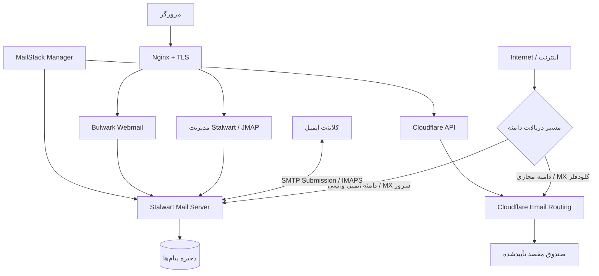

<div align="center" dir="rtl">

# ✉️ MailStack Installer

### نصب، مدیریت، حفاظت و فوروارد ایمیل — با یک اسکریپت

**نصب‌کننده و پنل مدیریت تعاملی Stalwart و Bulwark برای Ubuntu 24.04 LTS**

راه‌اندازی سرور ایمیل واقعی، مدیریت چنددامنه‌ای، تنظیم خودکار DNS کلودفلر، بکاپ رمزنگاری‌شده و یک بخش **کاملاً مجزای Virtual Mail** برای فوروارد ایمیل با Cloudflare Email Routing.

[](./install-mailstack.sh)
[](https://ubuntu.com/)
[](https://www.gnu.org/software/bash/)
[](https://github.com/amirkateb/mailstack-installer/stargazers)

[](https://github.com/amirkateb/mailstack-installer/releases)
[](https://github.com/amirkateb/mailstack-installer/forks)
[](https://github.com/amirkateb/mailstack-installer/issues)
[](https://github.com/amirkateb/mailstack-installer/commits/main/)

**[🇮🇷 فارسی](README.fa.md) · [🇬🇧 English](README.md) · [نصب](#نصب-سریع) · [ایمیل-مجازی](#ایمیل-مجازی-virtual-mail) · [انتشارها](https://github.com/amirkateb/mailstack-installer/releases)**

توسعه‌دهنده: **[amirmohammad katebsaber](https://github.com/amirkateb)**

</div>

> [!IMPORTANT]
> **این اسکریپت تنظیمات واقعی سرور را تغییر می‌دهد.** از جمله سرویس‌های ایمیل، فایروال، گواهی‌های SSL و DNS کلودفلر. پیش از اجرای عملیاتی، کد را بررسی کنید، از VPS اسنپ‌شات بگیرید و نخست روی یک دامنه آزمایشی اجرا کنید. تست‌های نسخه ۵ محلی و شبیه‌سازی‌شده بوده‌اند و جای آزمون واقعی روی Stalwart و Cloudflare شما را نمی‌گیرند.

## فهرست مطالب

- [معرفی پروژه](#معرفی-پروژه)
- [معماری سیستم](#معماری-سیستم)
- [امکانات نسخه ۵](#امکانات-نسخه-۵)
- [پیش‌نیازها](#پیشنیازها)
- [نصب سریع](#نصب-سریع)
- [نصب اولیه و DNS](#نصب-اولیه-و-dns)
- [منوی مدیریت و دستورات](#منوی-مدیریت-و-دستورات)
- [مدیریت چند دامنه واقعی](#مدیریت-چند-دامنه-واقعی)
- [ایمیل مجازی (Virtual Mail)](#ایمیل-مجازی-virtual-mail)
- [بکاپ و اطلاعات دسترسی](#بکاپ-بازیابی-و-اطلاعات-دسترسی)
- [پورت‌ها و تنظیمات کلاینت](#پورتها-و-تنظیمات-کلاینت)
- [عیب‌یابی و پایش](#عیبیابی-و-پایش)
- [آمار دانلود](#آمار-دانلود)
- [امنیت و محدودیت‌ها](#امنیت-و-محدودیتها)
- [تغییرات نسخه ۵](#تغییرات-نسخه-۵)
- [پشتیبانی و اعتبار](#پشتیبانی-و-اعتبار)

---

## معرفی پروژه

**MailStack Installer** یک اسکریپت Bash برای نصب و مدیریت چرخه عمر سرور ایمیل است. این پروژه پس از نصب اولیه هم به‌صورت یک پنل مدیریتی خط فرمان قابل استفاده است.

| جزء | کاربرد |
|---|---|
| [Stalwart Mail Server](https://stalw.art/) | دریافت و ارسال SMTP، IMAP، صندوق‌ها، دامنه‌ها و ذخیره پیام |
| [Bulwark Webmail](https://github.com/bulwarkmail/webmail) | محیط وب برای مشاهده ایمیل |
| [Nginx](https://nginx.org/) | Reverse Proxy رابط‌های وب |
| [Let's Encrypt](https://letsencrypt.org/) | صدور و تمدید گواهی TLS |
| [Cloudflare DNS](https://developers.cloudflare.com/dns/) | ایجاد و مدیریت رکوردهای دامنه و احراز اصالت ایمیل |
| [Cloudflare Email Routing](https://developers.cloudflare.com/email-routing/) | فوروارد **مجزای** ایمیل‌های مجازی به صندوق مقصد |
| `systemd` | سرویس‌ها، زمان‌بندی بکاپ، پایش و تکمیل فورواردهای معلق |

### تفاوت ایمیل واقعی و ایمیل مجازی

- **ایمیل واقعی (Stalwart):** پیام روی سرور دریافت و ذخیره می‌شود؛ کاربر با IMAP/Bulwark آن را می‌خواند و با SMTP احرازشده ارسال می‌کند.
- **ایمیل مجازی (Virtual Mail):** کلودفلر پیام دریافتی آدرس مجازی را به یک صندوق مقصدِ تأییدشده فوروارد می‌کند؛ **صندوق IMAP یا امکان ارسال SMTP با آن آدرس به‌تنهایی ساخته نمی‌شود.**

## معماری سیستم



> [!WARNING]
> **نباید Cloudflare Email Routing را روی همان دامنه‌ای فعال کنید که دریافت ایمیل آن با MX سرور Stalwart انجام می‌شود.** این دو مسیر دریافت، MX متفاوتی می‌خواهند. در نسخه ۵ برای جلوگیری از تداخل، جریان‌های مدیریتی از هم جدا شده‌اند و بررسی تعارض انجام می‌شود.

## امکانات نسخه ۵

| بخش | قابلیت‌ها |
|---|---|
| **نصب تعاملی** | بررسی Ubuntu، تشخیص IP عمومی، بررسی DNS/PTR، تست پورت ۲۵ و امکان ادامه نصب نیمه‌تمام |
| **سرور کامل ایمیل** | نصب و پیکربندی Stalwart، Bulwark، Nginx، TLS و تمدید گواهی |
| **DNS کلودفلر** | لینک ساخت توکن محدود، تنظیم A/MX و انتشار SPF/DKIM/DMARC براساس مقادیر واقعی Stalwart |
| **شبکه‌های محدود** | بررسی مخزن‌های Ubuntu، Mirror، رجیستری Docker و روش Native جایگزین برای Bulwark |
| **چنددامنه‌ای** | افزودن دامنه ثانویه Stalwart، توکن مجزای Zone، بررسی سلامت DNS و حذف مرحله‌ای با کنترل وابستگی |
| **Virtual Mail** | اتصال دامنه مجازی، افزودن/نمایش/ویرایش/حذف فوروارد، تأیید مقصد، Catch-all، تعویض توکن و پایش MX |
| **کاربران و ایمیل‌ها** | مدیریت حساب و Alias، مشاهده صف خروجی و تست ارسال SMTP احرازشده |
| **نگهداری** | به‌روزرسانی اجزا، تعمیر تنظیمات، سلامت سرویس، گزارش خطا و پیش‌نمایش DNS/مهاجرت |
| **پایداری و امنیت** | بکاپ رمزنگاری‌شده داده‌های محلی، تأیید و بازیابی، تایمر پایش، هشدار تلگرام و بررسی امنیت |
| **رمزها و توکن‌ها** | حفظ فایل TXT مدیریتی و اطلاعات Cloudflare با دسترسی محدود به root |

برخی امکانات عمداً **فقط خواندنی** هستند؛ مانند پیش‌نمایش مهاجرت، بررسی سیاست‌های MTA-STS/TLS-RPT/Autoconfig و بررسی صف. این اسکریپت انتقال واقعی پیام‌ها از سرویس‌دهنده قدیمی یا تحویل قطعی به Inbox را تضمین نمی‌کند.

## پیش‌نیازها

| مورد | حداقل پیشنهادی |
|---|---|
| سیستم‌عامل | **Ubuntu Server 24.04 LTS** — اسکریپت نسخه را بررسی می‌کند |
| دسترسی | `root` یا `sudo` |
| پردازنده و حافظه | حداقل حدود ۲ vCPU و ۲ تا ۴ گیگابایت RAM؛ وابسته به حجم استفاده |
| فضای ذخیره | ترجیحاً SSD با حدود ۴۰ گیگابایت به بالا، به‌علاوه فضای کافی برای صندوق‌ها |
| اینترنت | IPv4 عمومی ثابت؛ پورت ۲۵ ورودی و خروجی برای میزبانی واقعی ایمیل |
| دامنه | امکان مدیریت DNS؛ برای DNS خودکار، Zone کلودفلر و API Token مناسب |
| PTR | دسترسی به تنظیم Reverse DNS در پنل ارائه‌دهنده VPS |
| مخازن نرم‌افزاری | دسترسی به Repositoryها، نسخه‌های برنامه و سرویس صدور گواهی |

برای **Virtual Mail** روی نصب مدیریت‌شده، به دامنه جداگانه در Cloudflare و آدرس مقصد قابل تأیید نیاز دارید. محدودیت‌های خود سرویس Cloudflare Email Routing نیز اعمال می‌شوند.

## نصب سریع

### روش اول: دریافت Repository

```bash
sudo apt update
sudo apt install -y git
git clone https://github.com/amirkateb/mailstack-installer.git
cd mailstack-installer
bash -n install-mailstack.sh
sudo bash install-mailstack.sh
```

### روش دوم: دانلود مستقیم فایل اصلی

```bash
curl -fL --retry 3 \
  https://raw.githubusercontent.com/amirkateb/mailstack-installer/main/install-mailstack.sh \
  -o install-mailstack.sh

# بررسی اختیاری پیش از اجرا
bash -n install-mailstack.sh
sha256sum install-mailstack.sh

# کد را قبل از اجرای دسترسی root بررسی کنید.
sudo bash install-mailstack.sh
```

> **نکته:** این دستور فایل فعلی شاخه `main` را دریافت می‌کند و لزوماً برابر با یک Release یا نسخه تگ‌شده نیست. برای نصب نسخه ۵ از GitHub، باید ابتدا همین نسخه را در مخزن منتشر کرده باشید.

### ورود مجدد به پنل مدیریت

```bash
sudo bash install-mailstack.sh
# یا در صورت وجود نسخه مدیریتی پایدار روی سرور:
sudo /usr/local/sbin/katebsaber-mailstack-manager
```

در نصب شناخته‌شده، اسکریپت معمولاً منوی مدیریت را باز می‌کند. گزینه `--install` مخصوص زمانی است که **عمداً** قصد اجرای فرایند نصب یا ادامه آن را دارید.

## نصب اولیه و DNS

جریان نصب شامل بررسی سیستم، دریافت دامنه، تنظیم hostname، اعتبارسنجی توکن Cloudflare، رکوردهای اولیه، نصب Stalwart و Bulwark، تنظیم Nginx و SSL، رکوردهای احراز اصالت و بررسی سلامت نهایی است.

نمونه:

```text
دامنه اصلی:       example.com
سرور ایمیل:       mail.example.com
وب‌میل:           webmail.example.com
IPv4 عمومی:       203.0.113.10  (فقط IP نمونه مستندات)
```

| نوع | نام | مقدار | توضیح |
|---|---|---|---|
| `A` | `mail.example.com` | `203.0.113.10` | برای SMTP/IMAP حالت **DNS Only** |
| `A` | `webmail.example.com` | `203.0.113.10` | سرویس HTTP/S در صورت تنظیم صحیح می‌تواند Proxy داشته باشد |
| `MX` | `example.com` | `mail.example.com` | معمولاً با اولویت `10` |
| `PTR` | `203.0.113.10` | `mail.example.com` | در پنل VPS، نه Cloudflare |
| `TXT` | SPF/DKIM/DMARC | **مقدار واقعی تولیدشده توسط Stalwart** | کلید DKIM را حدس نزنید |

اسکریپت لینک ساخت توکن محدود به دامنه را نمایش می‌دهد. بسته به عملیات، برخی مجوزهای Write صرفاً هنگام انجام تغییر واقعی قابل تأیید هستند. انتشار DNS و اعمال PTR ممکن است زمان‌بر باشد.

بعد از نصب:

- پنل Stalwart: `https://mail.example.com/admin`
- وب‌میل Bulwark: `https://webmail.example.com`

## منوی مدیریت و دستورات

پنل مدیریت نسخه ۵ دارای **۳۰ گزینه** است:

| گزینه | کاربرد |
|---|---|
| `1–3` | نسخه‌ها، اطلاعات ورود ذخیره‌شده و سلامت سیستم |
| `4–9` | آپدیت Stalwart/CLI/Bulwark/اجزای سیستم و تعمیر تنظیمات |
| `10–11` | لاگ‌ها و اجرای مجدد/ادامه نصب |
| `12–15` | مشاهده، افزودن، حذف مرحله‌ای و بررسی دامنه‌های واقعی |
| `16–17` | مدیریت حساب/نام مستعار و صف خروجی |
| `18–22` | بکاپ رمزنگاری‌شده، اعتبارسنجی، بازیابی، تایمرها و هشدار تلگرام |
| `23–25` | پیش‌نمایش مهاجرت، آزمایش SMTP و بررسی امنیت |
| `26–29` | تعویض توکن، لغو حذف دامنه، پیش‌نمایش DNS و بررسی پیشرفته DNS |
| **`30`** | **Virtual Mail — پنل مستقل فوروارد Cloudflare** |

دستورهای نمونه:

```bash
sudo bash install-mailstack.sh --help
sudo bash install-mailstack.sh --status
sudo bash install-mailstack.sh --list-domains
sudo bash install-mailstack.sh --add-domain
sudo bash install-mailstack.sh --remove-domain
sudo bash install-mailstack.sh --domain-health
sudo bash install-mailstack.sh --accounts
sudo bash install-mailstack.sh --queue
sudo bash install-mailstack.sh --backup-now
sudo bash install-mailstack.sh --alerts
sudo bash install-mailstack.sh --test-mail
sudo bash install-mailstack.sh --security-review
sudo bash install-mailstack.sh --virtual-mail
```

سایر گزینه‌ها: `--verify-backup PATH`، `--restore-backup PATH`، `--backup-timer`، `--update-all`، `--dns-preview`، `--advanced-dns`، `--rotate-cf-token`، `--migration-plan`، `--reconfigure`، `--reset-progress`، `--core-dns`، `--full-dns`، `--skip-ptr-check` و `--non-interactive`. پیش از اجرای گزینه‌های بازیابی یا تغییر DNS، اثر آن‌ها را بررسی کنید.

## مدیریت چند دامنه واقعی

با گزینه **۱۳** می‌توانید دامنه ایمیل جدیدی را به Stalwart موجود اضافه کنید. اسکریپت برای دامنه جدید **توکن Cloudflare مربوط به Zone همان دامنه** را می‌خواهد، دسترسی را بررسی می‌کند، تعارض DNS را کنترل می‌کند و دامنه را در ساختار موجود قرار می‌دهد. همه این دامنه‌ها از همان سرویس‌های SMTP و IMAP سرور استفاده می‌کنند.

گزینه **۱۴** حذف دامنه ثانویه را با **فرایند دومرحله‌ای و بازه بررسی ۷روزه** انجام می‌دهد. دامنه اصلی از این طریق قابل حذف نیست؛ وابستگی حساب‌ها و Aliasها بررسی می‌شود و تغییرات DNS با کنترل انجام می‌شوند. گزینه **۲۷** برای لغو حذف در انتظار است.

> قبل از حذف دامنه‌ای که واقعاً استفاده می‌شود، بکاپ مستقل بگیرید و وابستگی‌های آن را بررسی کنید. حذف مرحله‌ای ریسک را کاهش می‌دهد اما تضمین بازگردانی تمام عملیات خارجی نیست.

## ایمیل مجازی (Virtual Mail)

**Virtual Mail یک سیستم مستقل از مدیریت دامنه‌های واقعی Stalwart است.** در این بخش آدرس فوروارد ساخته می‌شود، نه صندوق ایمیل با فضای ذخیره‌سازی.

```text
newsletter@virtual-example.com
            │
            ▼
  Cloudflare Email Routing
            │
            ▼
    my-inbox@gmail.com
```

### راه‌اندازی قدم‌به‌قدم

1. از منوی اصلی، گزینه **۳۰ — Virtual Mail** را انتخاب کنید؛ یا `--virtual-mail` را اجرا کنید.
2. گزینه **۱ — اتصال دامنه و توکن** را بزنید؛ لینک ساخت API Token محدود Cloudflare نمایش داده می‌شود.
3. Zone و Account مربوط را انتخاب کنید و دسترسی‌های موردنیاز جدول زیر را بدهید. دامنه نباید هم‌زمان روی سرویس ایمیل دیگری MX فعال داشته باشد.
4. اسکریپت MXهای موجود را بررسی می‌کند؛ فعال‌سازی Email Routing را با تأیید صریح انجام دهید.
5. با گزینه **۳** آدرس مجازی (مثلاً `hello@virtual-example.com`) و ایمیل مقصد را وارد کنید.
6. **ایمیل تأیید Cloudflare را در صندوق مقصد باز کنید و روی لینک تأیید بزنید.** این مرحله را نمی‌توان با API Token دور زد.
7. گزینه **۵** فوروارد معلق را تکمیل می‌کند؛ همچنین تایمر `systemd` جداگانه تقریباً **هر ۱۰ دقیقه** درخواست‌های معلق را بررسی می‌کند.
8. با گزینه **۱۱** سلامت Cloudflare و MX را بررسی کنید و یک ایمیل آزمایشی واقعی بفرستید.

### سطح دسترسی توکن Cloudflare

| محدوده | مجوز | کاربرد |
|---|---|---|
| Zone | `Zone → Read` | شناسایی Zone |
| Zone | `DNS → Read` | مشاهده رکوردهای MX |
| Zone | `Zone Settings → Edit` | پیش‌نیازهای فعال‌سازی Routing |
| Zone | `Email Routing Rules → Edit` | ساخت، تغییر و حذف فورواردها |
| Account | `Email Routing Addresses → Edit` | ثبت آدرس مقصد |

لینک ساخت توکن ممکن است تنها بخشی از مجوزها را از پیش انتخاب کند. **همه دسترسی‌ها را بررسی و در صورت نیاز دستی اضافه کنید** و دامنه/حساب را تا حد امکان محدود انتخاب کنید. اسامی مجوزها ممکن است در Cloudflare تغییر کنند.

### منوی مستقل Virtual Mail

| شماره | عملکرد |
|---|---|
| `1` | اتصال دامنه و توکن، فعال‌سازی Cloudflare Email Routing |
| `2` | فهرست دامنه‌های مجازی و وضعیتشان |
| `3` | افزودن فوروارد ایمیل مجازی |
| `4` | نمایش قوانین فعال/غیرفعال و درخواست‌های معلق |
| `5` | تکمیل فوروارد پس از تأیید مقصد |
| `6` | تغییر مقصد یک آدرس |
| `7` | حذف قانون فوروارد یا لغو درخواست معلق |
| `8` | نمایش مقصدها و وضعیت تأیید |
| `9` | تنظیم فوروارد Catch-all |
| `10` | تعویض توکن و آرشیو توکن قبلی |
| `11` | بررسی سلامت Routing و DNS |
| `12` | غیرفعال‌سازی Routing دامنه بدون قانون فعال با کنترل‌های ایمنی |

حذف فوروارد **صندوق مقصد مشترک، دامنه یا توکن ذخیره‌شده را حذف نمی‌کند.** فایل‌ها و زمان‌بند Virtual Mail جدا از مدیریت Stalwart هستند.

**محدودیت:** سرویس Email Routing به‌خودی‌خود IMAP، POP3 یا SMTP ارسال فراهم نمی‌کند. تحویل ایمیل تابع محدودیت‌های Cloudflare، تأیید مقصد و وضعیت DNS است و هیچ تضمینی برای رسیدن پیام به Inbox وجود ندارد.

مستندات رسمی: [Email Routing](https://developers.cloudflare.com/email-routing/) · [API کلودفلر](https://developers.cloudflare.com/api/resources/email_routing/) · [API Token](https://developers.cloudflare.com/fundamentals/api/get-started/create-token/)

## بکاپ، بازیابی و اطلاعات دسترسی

**فایل TXT رمزها و توکن‌ها عمداً حفظ می‌شود و حذف نشده است.** مسیرهای مهم:

```text
/root/mailstack-secrets.txt                  # اطلاعات ورود و توکن‌ها؛ مخصوص root
/root/mailstack-backup-passphrase.txt       # رمز بکاپ محلی
/var/lib/katebsaber-mailstack-installer/     # وضعیت نصب، دامنه‌ها و بکاپ‌ها
/var/lib/katebsaber-mailstack-installer/virtual-mail/  # تنظیمات و توکن‌های مستقل ایمیل مجازی
/var/log/katebsaber-mailstack-installer-*.log
```

سطح دسترسی فایل‌های حساس در حالت عادی باید مخصوص root باشد (مانند `0600` برای TXT و Token). **هرگز این فایل‌ها را در GitHub، Issue، اسکرین‌شات عمومی یا بکاپ بدون حفاظت قرار ندهید.** چون اطلاعات ورود به‌صورت متنی برای مدیریت نگهداری می‌شوند، افشای آن‌ها می‌تواند دسترسی کامل به ایمیل یا DNS بدهد.

در منوی مدیریت:

- **۱۸:** تهیه بکاپ سرد و رمزنگاری‌شده از داده‌ها و تنظیمات **محلی و پشتیبانی‌شده**.
- **۱۹:** بررسی اعتبار فایل بکاپ.
- **۲۰:** بازیابی با تأیید صریح مدیر.
- **۲۱:** نصب زمان‌بند بکاپ و کنترل سلامت/هشدار.

دستورهای نمونه:

```bash
sudo bash install-mailstack.sh --backup-now
sudo bash install-mailstack.sh --verify-backup /absolute/path/to/backup.archive
sudo bash install-mailstack.sh --restore-backup /absolute/path/to/backup.archive
```

نام فایل `.archive` صرفاً **نمونه مسیر** است؛ مسیر واقعی را از خروجی بکاپ بردارید. یک نسخه بکاپ رمزنگاری‌شده را **خارج از سرور** نگه دارید و بازیابی را در محیط آزمایشی تست کنید. اگر ذخیره‌سازی یا پایگاه داده خارجی به نصب اضافه کرده‌اید، برای آن بکاپ جداگانه لازم است.

## پورت‌ها و تنظیمات کلاینت

| پورت | پروتکل | کاربرد |
|---:|---|---|
| `25/tcp` | SMTP | دریافت/ارسال بین سرورهای ایمیل |
| `465/tcp` | SMTP TLS | ارسال احرازشده |
| `587/tcp` | SMTP STARTTLS | ارسال احرازشده |
| `993/tcp` | IMAP TLS | دریافت پیام صندوق |
| `80/tcp` | HTTP | چالش SSL و ریدایرکت |
| `443/tcp` | HTTPS | مدیریت و وب‌میل |
| `127.0.0.1:8080` | HTTP داخلی | رابط/ API مربوط به Stalwart |
| `127.0.0.1:3000` | HTTP داخلی | سرویس Bulwark |

**کلاینت ایمیل:** برای IMAP آدرس `mail.example.com` و پورت `993` با SSL/TLS؛ برای SMTP پورت `465` با SSL/TLS یا `587` با STARTTLS؛ نام کاربری معمولاً `user@example.com` با رمز همان حساب است.

پورت‌های داخلی را در اینترنت منتشر نکنید. SMTP/IMAP را نیز از Proxy معمولی HTTP کلودفلر عبور ندهید.

## عیب‌یابی و پایش

```bash
# وضعیت سرویس‌ها و لاگ‌ها
sudo systemctl status stalwart nginx
sudo journalctl -u stalwart -n 100 --no-pager
sudo nginx -t
sudo systemctl list-timers --all | grep -E 'mailstack|stalwart' || true

# DNS و PTR
dig +short MX example.com
dig +short TXT example.com
dig +short TXT _dmarc.example.com
dig +short A mail.example.com
dig -x 203.0.113.10 +short

# گواهی و TLS
openssl s_client -connect mail.example.com:993 -servername mail.example.com </dev/null
openssl s_client -connect mail.example.com:465 -servername mail.example.com </dev/null

# وب‌سرویس‌های محلی با پورت پیش‌فرض
curl -I http://127.0.0.1:8080
curl -I http://127.0.0.1:3000
```

**اگر ایمیل دریافت نمی‌شود:** ابتدا رکورد MX واقعی، باز بودن پورت ۲۵، انتشار DNS، وجود گیرنده و لاگ‌های Stalwart را بررسی کنید. **اگر ارسال رد می‌شود:** احراز هویت SMTP، SPF/DKIM/DMARC، PTR، اعتبار IP و پاسخ سرور مقصد را بررسی کنید.

**اگر Virtual Mail معلق ماند:** ایمیل تأیید مقصد را بررسی کنید و سپس گزینه‌های **۳۰ → ۴/۵/۸/۱۱**، دسترسی توکن و سرویس زمان‌بندی‌شده را ببینید:

```bash
sudo systemctl status katebsaber-mailstack-virtual-mail.timer
sudo journalctl -u katebsaber-mailstack-virtual-mail.service -n 100 --no-pager
```

موفقیت SPF/DKIM/DMARC یا پاسخ SMTP به معنای تضمین ورود به Inbox نیست؛ اعتبار IP و دامنه و سیاست سرویس مقصد نیز اثر دارند.

## آمار دانلود

نشان بالای README، **تعداد دانلود فایل‌های پیوست‌شده به GitHub Releases** را با استفاده از [Shields.io](https://shields.io/badges/git-hub-downloads-all-assets-all-releases) نشان می‌دهد. این شمارنده **شامل** دانلود با `git clone`، دریافت مستقیم فایل `raw.githubusercontent.com` یا دانلود آرشیو سورس در GitHub **نیست**.

در زمان تهیه این مستندات، مخزن هنوز **Release منتشرشده ندارد**؛ بنابراین عدد نشان دانلود هنوز آمار واقعی استفاده از اسکریپت را نشان نمی‌دهد. برای فعال‌شدن شمارنده:

1. صفحه [Releases مخزن](https://github.com/amirkateb/mailstack-installer/releases) را باز کنید و **Draft a new release** را بزنید.
2. تگی مانند `v5.0.0` بسازید، فایل `install-mailstack.sh` را به‌عنوان **Release Asset** پیوست کنید و Release را منتشر کنید.
3. نشان موجود در README بعد از دانلود فایل‌های Release، به‌صورت خودکار به‌روز می‌شود.

برای مشاهده بازدیدها و Cloneها، مالک مخزن می‌تواند وارد **Insights → Traffic** شود. این گزارش، بازه زمانی محدود را نشان می‌دهد و معادل شمارنده تمام دانلودهای Installer نیست. [مستندات آمار GitHub](https://docs.github.com/en/rest/metrics/traffic).

## امنیت و محدودیت‌ها

- برای هر Zone در Cloudflare تا حد امکان از توکن محدود با کمترین مجوز استفاده کنید.
- فایل `/root/mailstack-secrets.txt` و آرشیو آن را تنها در اختیار root نگه دارید. **نگهداری رمزها به شکل TXT یک انتخاب آگاهانه برای مدیریت است، نه سامانه رمزنگاری‌شده مدیریت اسرار.**
- سیستم‌عامل، Stalwart، Bulwark و Docker را به‌روز نگه دارید و پس از تغییر تنظیمات، فایروال و Nginx را بررسی کنید.
- رکورد **PTR** توسط ارائه‌دهنده سرور تنظیم می‌شود و از طریق DNS عمومی Cloudflare قابل تنظیم نیست.
- پیش از تغییر MX دامنه‌ای که ایمیل فعال دارد، برنامه مهاجرت و زمان‌بندی قطعی تهیه کنید.
- پس از نصب حتماً ارسال و دریافت واقعی با Gmail/Outlook یا مقصد آزمایشی انجام دهید.
- هیچ Rollbackای نمی‌تواند همه اقدامات سرویس‌دهندگان خارجی را در هر شرایطی بازگرداند؛ Snapshot و بکاپ مستقل ضروری است.
- آزمایش‌های نسخه ۵ شامل تست نحوی، تست‌های آفلاین و Mock API بوده‌اند؛ **تأیید کامل در محیط عملیاتی انجام نشده است.**

## تغییرات نسخه ۵

**نسخه 5.0.0 — افزودن Virtual Mail مستقل با Cloudflare Email Routing**

- منوی جدید **۳۰ — Virtual Mail** و دستور `--virtual-mail`.
- اتصال Zone و Account با API Token محدود، کنترل MX و تضاد با دامنه‌های Stalwart.
- افزودن، مشاهده، ویرایش و حذف آدرس‌های مجازی و مدیریت Catch-all.
- ثبت درخواست معلق برای مقصد تأییدنشده و تلاش مجدد با تایمر جداگانه.
- تعویض توکن و نگهداری آرشیو توکن قبلی؛ حفظ فایل مدیریتی TXT.
- حفظ سایر امکانات نسخه قبلی مانند مدیریت چنددامنه‌ای، حساب‌ها، بکاپ و هشدارها.

تغییرات منتشرشده را از [تاریخچه GitHub](https://github.com/amirkateb/mailstack-installer/commits/main/) و در صورت ایجاد Release از [صفحه انتشارها](https://github.com/amirkateb/mailstack-installer/releases) دنبال کنید.

## پشتیبانی و اعتبار

- **Repository:** [amirkateb/mailstack-installer](https://github.com/amirkateb/mailstack-installer)
- **گزارش باگ و پیشنهاد:** [GitHub Issues](https://github.com/amirkateb/mailstack-installer/issues)
- **سازنده:** [amirmohammad katebsaber](https://github.com/amirkateb)
- **مراجع رسمی:** [Stalwart](https://stalw.art/docs/) · [Cloudflare](https://developers.cloudflare.com/email-routing/) · [Let's Encrypt](https://letsencrypt.org/docs/)

### مجوز انتشار

**این README به‌تنهایی هیچ مجوزی را اعلام نمی‌کند.** اگر قصد انتشار با مجوز MIT یا هر مجوز متن‌باز دیگری دارید، فایل `LICENSE` متناسب را به Repository اضافه کنید. نوشتن نام مجوز در README به‌تنهایی به معنی اعطای آن نیست.

### سلب مسئولیت

میزبانی ایمیل به نگهداری مستمر، امنیت، بکاپ، DNS، جلوگیری از سوءاستفاده، پایش و مدیریت اعتبار ارسال نیاز دارد. MailStack فرایند نصب و نگهداری را ساده‌تر می‌کند اما دسترس‌پذیری دائمی، تحویل قطعی یا ورود تضمینی به Inbox را فراهم نمی‌کند. مسئولیت بررسی و تأیید تغییرات روی زیرساخت بر عهده مدیر آن است.

<div align="center" dir="rtl">

**برای کسانی که می‌خواهند کنترل زیرساخت ایمیل خودشان را در دست داشته باشند.**

[↑ بازگشت به بالا](#-mailstack-installer) · [English](README.md)

</div>
