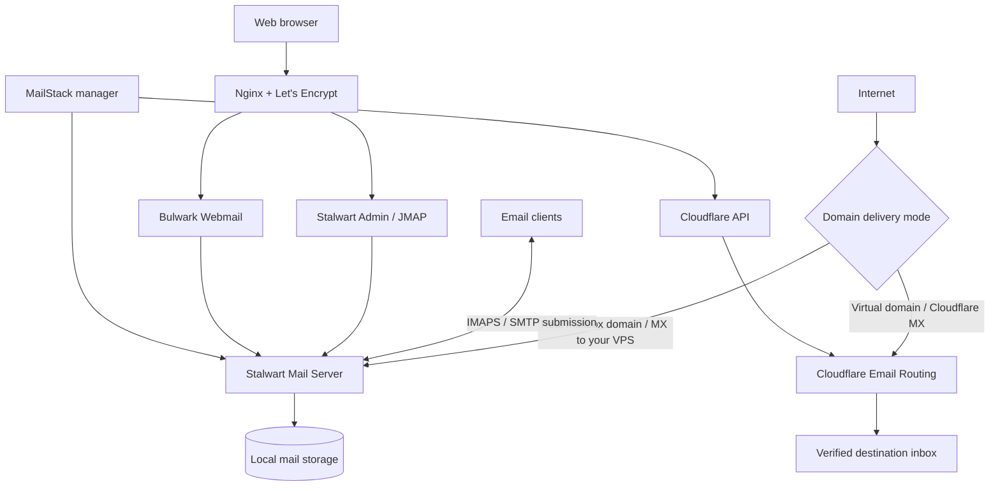

<div align="center">

# ✉️ MailStack Installer

### Deploy. Manage. Protect. Forward.

**An interactive Stalwart + Bulwark mail server installer and lifecycle manager for Ubuntu 24.04 LTS.**

Full mail hosting, multi-domain management, Cloudflare DNS automation, encrypted backups, and an **independent Virtual Mail manager** powered by Cloudflare Email Routing — in one Bash script.

[](./install-mailstack.sh)
[](https://ubuntu.com/)
[](https://www.gnu.org/software/bash/)
[](https://github.com/amirkateb/mailstack-installer/stargazers)

[](https://github.com/amirkateb/mailstack-installer/releases)
[](https://github.com/amirkateb/mailstack-installer/forks)
[](https://github.com/amirkateb/mailstack-installer/issues)
[](https://github.com/amirkateb/mailstack-installer/commits/main/)

**[English](README.md) · [فارسی / Persian](README.fa.md) · [Install](#quick-installation) · [Virtual Mail](#virtual-mail--cloudflare-email-routing) · [Releases](https://github.com/amirkateb/mailstack-installer/releases)**

Created by **[amirmohammad katebsaber](https://github.com/amirkateb)**.

</div>

> [!IMPORTANT]
> **MailStack changes real infrastructure.** It configures mail services, firewall rules, certificates, and Cloudflare DNS. Review the source, take a VPS snapshot, and test on an unused domain before running against production mail. The v5 test suite uses local mocks; real-world Cloudflare and Stalwart compatibility must be validated on your deployment.

## Contents

- [What is MailStack?](#what-is-mailstack)
- [Architecture](#architecture)
- [Features](#features)
- [Requirements](#requirements)
- [Quick installation](#quick-installation)
- [First-time setup and DNS](#first-time-setup-and-dns)
- [Management menu and CLI](#management-menu-and-cli)
- [Multiple real mail domains](#multiple-real-mail-domains)
- [Virtual Mail — Cloudflare Email Routing](#virtual-mail--cloudflare-email-routing)
- [Backups, recovery, and credentials](#backups-recovery-and-credentials)
- [Mail clients and ports](#mail-clients-and-ports)
- [Monitoring and troubleshooting](#monitoring-and-troubleshooting)
- [Download statistics](#download-statistics)
- [Security and limitations](#security-and-limitations)
- [Version 5 highlights](#version-5-highlights)
- [Support and credits](#support-and-credits)

---

## What is MailStack?

**MailStack Installer** combines provisioning and ongoing operations in the same script:

| Component | Purpose |
|---|---|
| [Stalwart Mail Server](https://stalw.art/) | SMTP, submission, IMAP, accounts, domains, and mail storage |
| [Bulwark Webmail](https://github.com/bulwarkmail/webmail) | Browser-based mailbox access |
| [Nginx](https://nginx.org/) | Reverse proxy for the web interfaces |
| [Let's Encrypt](https://letsencrypt.org/) | TLS certificates and renewal hooks |
| [Cloudflare DNS](https://developers.cloudflare.com/dns/) | Record management and mail authentication records |
| [Cloudflare Email Routing](https://developers.cloudflare.com/email-routing/) | **Separate** receive-and-forward-only virtual addresses |
| `systemd` | Mail services, scheduled backups, health checks, and pending-forward reconciliation |

**Two different kinds of email addresses:**

- **Real mailboxes:** Stalwart accepts and stores email; users read it via IMAP/Bulwark and send via authenticated SMTP.
- **Virtual Mail:** Cloudflare receives messages addressed to a virtual alias and forwards them to a verified external inbox. **No IMAP mailbox or outbound SMTP identity is created.**

## Architecture



> [!WARNING]
> Do **not** enable Cloudflare Email Routing for the **same mail domain** that is receiving email on Stalwart. The systems require different MX routing. MailStack v5 keeps these workflows separate and checks for conflicts.

## Features

| Area | Capabilities in v5 |
|---|---|
| **Guided setup** | Ubuntu checks, public IPv4, DNS and PTR checks, port 25 connectivity, restartable installation steps |
| **Full mail stack** | Stalwart, Bulwark, Nginx, automatic TLS and certificate renewal integration |
| **Cloudflare DNS** | Restricted API token onboarding, A/MX setup, Stalwart-generated SPF/DKIM/DMARC records |
| **Network fallbacks** | Repository and container registry checks; alternate Docker/mirror options; native Bulwark fallback |
| **Multiple domains** | Add secondary Stalwart domains; zone-scoped tokens; domain DNS health; guarded, staged retirement |
| **Virtual Mail** | Connect Cloudflare zones, add/list/change/delete forwards, recipient verification, pending queue, catch-all, token rotation, MX health |
| **Accounts and mail** | Account and alias tools, outgoing queue overview, authenticated SMTP send test |
| **Operations** | Component updates, configuration repair, service health, logs, read-only migration/DNS previews |
| **Protection** | Encrypted local-data backups, verification, explicit restore, health timers, Telegram alerts, security review |
| **Credentials** | Existing root-only TXT credentials file preserved; per-zone Cloudflare tokens retained and rotatable |

Some actions are intentionally **read-only**: migration previews, advanced MTA-STS/TLS-RPT/autoconfig inspection, and queue inspection. MailStack does **not** automatically migrate messages from an external provider or guarantee inbox delivery.

## Requirements

| Item | Recommended baseline |
|---|---|
| Operating system | **Ubuntu Server 24.04 LTS** (checked by the script) |
| Access | `root` or `sudo` |
| CPU / RAM | 2 vCPU / 2–4 GB RAM or more, depending on mailbox load |
| Disk | SSD, approximately 40 GB or more **plus actual mailbox capacity** |
| Network | Public static IPv4; inbound/outbound TCP port **25** available for full mail hosting |
| Domain | Domain with DNS control; Cloudflare zone and suitable API token for automated DNS |
| Deliverability | PTR / reverse DNS managed by the VPS provider |
| Other | Internet access to package repositories, upstream releases, and certificate providers |

For **Virtual Mail** on an already managed installation, a separate Cloudflare domain and verified destination inbox are required. Cloudflare's Email Routing has its own service limits and restrictions; consult its documentation.

## Quick installation

**Option A — clone the GitHub repository**

```bash
sudo apt update
sudo apt install -y git
git clone https://github.com/amirkateb/mailstack-installer.git
cd mailstack-installer
bash -n install-mailstack.sh
sudo bash install-mailstack.sh
```

**Option B — download just the installer**

```bash
curl -fL --retry 3 \
  https://raw.githubusercontent.com/amirkateb/mailstack-installer/main/install-mailstack.sh \
  -o install-mailstack.sh

# Optional pre-execution checks
bash -n install-mailstack.sh
sha256sum install-mailstack.sh

# Review the script before granting root access.
sudo bash install-mailstack.sh
```

Always inspect a root-executed script from the branch/revision you trust. The commands above download the **current `main` file**, which may differ from a tagged release. The default branch must contain v5 before you use these commands to install v5.

**Reopen the manager on an installed server:**

```bash
sudo bash install-mailstack.sh
# or, when the persistent manager is installed:
sudo /usr/local/sbin/katebsaber-mailstack-manager
```

Re-running the installer normally detects a managed installation and opens the management menu. **Use `--install` only when you intentionally want to run/resume provisioning.**

## First-time setup and DNS

The guided workflow covers system validation, domain and hostname setup, Cloudflare token verification, DNS bootstrap, Stalwart and Bulwark deployment, Nginx, TLS, authentication records, and final health checks.

Example domain layout:

```text
Primary domain:  example.com
Mail host:       mail.example.com
Webmail:         webmail.example.com
Public IPv4:     203.0.113.10  (documentation example only)
```

Typical records:

| Type | Hostname | Value | Notes |
|---|---|---|---|
| `A` | `mail.example.com` | `203.0.113.10` | **DNS only** for SMTP/IMAP |
| `A` | `webmail.example.com` | `203.0.113.10` | HTTP/S may be proxied separately if configured correctly |
| `MX` | `example.com` | `mail.example.com` | Priority typically `10` |
| `PTR` | `203.0.113.10` | `mail.example.com` | Set at **VPS provider**, not Cloudflare |
| `TXT` | SPF / DKIM / DMARC | **Use Stalwart's real generated values** | Do not invent DKIM keys |

Cloudflare tokens must be scoped to the necessary zone(s). The installer supplies a token-creation link and checks access; some write permissions can only be validated when an actual change is made. DNS propagation and PTR adjustments may take time.

**Useful post-install addresses** (replace `example.com`):

- Stalwart administration: `https://mail.example.com/admin`
- Bulwark webmail: `https://webmail.example.com`

## Management menu and CLI

The installed manager provides **30 options**, grouped below (numbers match the v5 script):

| Menu items | Function |
|---|---|
| `1–3` | Versions, stored access details, health |
| `4–9` | Stalwart, CLI, Bulwark, system component updates; configuration repair |
| `10–11` | Logs; run/resume provisioning |
| `12–15` | List/add/retire real domains and review DNS health |
| `16–17` | Account/alias management; outbound queue overview |
| `18–22` | Encrypted backups, verification, restore, scheduled tasks, Telegram alerts |
| `23–25` | Migration preview, SMTP test, security review |
| `26–29` | Token rotation, cancel domain retirement, DNS preview, advanced DNS review |
| **`30`** | **Virtual Mail — independent Cloudflare Email Routing menu** |

A selection of supported command-line options:

```bash
sudo bash install-mailstack.sh --help
sudo bash install-mailstack.sh --status
sudo bash install-mailstack.sh --list-domains
sudo bash install-mailstack.sh --add-domain
sudo bash install-mailstack.sh --remove-domain
sudo bash install-mailstack.sh --domain-health
sudo bash install-mailstack.sh --accounts
sudo bash install-mailstack.sh --queue
sudo bash install-mailstack.sh --backup-now
sudo bash install-mailstack.sh --alerts
sudo bash install-mailstack.sh --test-mail
sudo bash install-mailstack.sh --security-review
sudo bash install-mailstack.sh --virtual-mail
```

Additional supported options include `--verify-backup PATH`, `--restore-backup PATH`, `--backup-timer`, `--update-all`, `--dns-preview`, `--advanced-dns`, `--rotate-cf-token`, `--migration-plan`, `--reconfigure`, `--reset-progress`, `--core-dns`, `--full-dns`, `--skip-ptr-check`, and `--non-interactive`. **Do not use recovery, DNS-write, or destructive options without understanding their effect.**

## Multiple real mail domains

Use menu **13** to add another real mail domain to the existing Stalwart installation. MailStack requests a **Cloudflare token for that zone**, validates access, checks DNS conflicts and creates/updates the domain configuration. Secondary domains share the existing server and service endpoints, rather than deploying another mail stack.

Menu **14** performs a **guarded, two-stage retirement with a seven-day review window**. The primary domain cannot be removed this way; account and alias dependencies are checked and DNS changes are scoped. Menu **27** cancels a pending retirement.

> Always take an independent backup and inspect dependencies before deleting a live domain. A multi-stage deletion process is a safety measure, **not a universal rollback guarantee**.

## Virtual Mail — Cloudflare Email Routing

**Virtual Mail is separate from Stalwart mail hosting**. It creates forwarding rules, not mailboxes.

```text
newsletter@virtual-example.com
            │
            ▼
  Cloudflare Email Routing
            │
            ▼
    my-inbox@gmail.com
```

### Step-by-step

1. Open the manager and choose **30 → Virtual Mail** (or run `--virtual-mail`).
2. Choose **1 → Connect domain + token**; create the requested restricted Cloudflare API token using the link printed by the installer.
3. Select the relevant Cloudflare **zone and account** and grant the required permissions (below). Use a domain **without another active mail receiver**.
4. Let the installer check MX conflicts; explicitly confirm Email Routing activation.
5. Choose **3 → Add virtual email forward**. Enter a source such as `hello@virtual-example.com` and the destination address.
6. **Open the destination inbox and click Cloudflare's verification link.** An API token cannot bypass recipient ownership verification.
7. Choose **5 → Complete forwarding** or allow the isolated `systemd` timer to check pending forwards approximately every **10 minutes**.
8. Choose **11 → Health check**, then send a real external test email to verify end-to-end delivery.

**Cloudflare token permissions requested by v5:**

| Scope | Permission | Purpose |
|---|---|---|
| Zone | `Zone → Read` | Locate the managed zone |
| Zone | `DNS → Read` | Check current MX records |
| Zone | `Zone Settings → Edit` | Manage Email Routing setup requirements |
| Zone | `Email Routing Rules → Edit` | Add, update, and delete forwarding rules |
| Account | `Email Routing Addresses → Edit` | Register recipient destinations |

Some template parameters may preselect only part of this list. **Review and add all required permissions manually**, constrained to the intended zone/account. Cloudflare permission names and behavior can change.

### Independent Virtual Mail submenu

| Number | Action |
|---|---|
| `1` | Connect domain/token and enable Email Routing |
| `2` | Show connected domains and status |
| `3` | Add a virtual forwarding address |
| `4` | List active/inactive rules and pending requests |
| `5` | Complete pending forwards after recipient verification |
| `6` | Change forwarding destination |
| `7` | Delete an individual forwarding rule or pending request |
| `8` | View destinations and verification states |
| `9` | Configure catch-all forwarding |
| `10` | Rotate the Cloudflare token, archiving the old one |
| `11` | Check Routing/DNS health |
| `12` | Disable routing on an unused domain with safety checks |

Deleting a rule does **not** delete the shared account-level destination inbox, the domain, or its saved token. Virtual Mail's state, files, timer, and API requests are isolated from the Stalwart domain-management workflow.

**Virtual Mail limitations:** Cloudflare forwarding cannot by itself provide IMAP/POP3 access, an SMTP send-as account, arbitrary mail migration, or guaranteed delivery. It uses Cloudflare's MX routing for the enabled domain and is subject to its limits and destination-verification process.

Official guides: [Cloudflare Email Routing](https://developers.cloudflare.com/email-routing/) · [Cloudflare Email Routing API](https://developers.cloudflare.com/api/resources/email_routing/) · [Cloudflare API tokens](https://developers.cloudflare.com/fundamentals/api/get-started/create-token/)

## Backups, recovery, and credentials

**The credentials TXT is intentionally preserved.** The installer continues to maintain:

```text
/root/mailstack-secrets.txt                  # Root-only credentials / token record
/root/mailstack-backup-passphrase.txt       # Local backup passphrase
/var/lib/katebsaber-mailstack-installer/     # Installer state, domain metadata, backup inventory
/var/lib/katebsaber-mailstack-installer/virtual-mail/  # Isolated Virtual Mail state/tokens
/var/log/katebsaber-mailstack-installer-*.log
```

Private files are intended to be restricted to root (for example `0600` for token/TXT files). **No credentials should ever be committed to GitHub, pasted into an issue, or stored in a public backup.** Because the TXT contains usable secrets, anyone with root access or an unencrypted copy may impersonate the mail administrator or change DNS.

The manager supports:

- **18:** cold, encrypted backup of supported **local** mail data and configuration;
- **19:** archive verification;
- **20:** explicit, confirmed recovery;
- **21:** scheduled backup and health/alert timers.

CLI examples:

```bash
sudo bash install-mailstack.sh --backup-now
sudo bash install-mailstack.sh --verify-backup /absolute/path/to/backup.archive
sudo bash install-mailstack.sh --restore-backup /absolute/path/to/backup.archive
```

The archive filename above is a **placeholder**; use the actual output path. A local backup is not enough: store a protected copy **off-server**, retain the passphrase separately, and regularly test restoration in a non-production environment. External databases/storage, if introduced by a customized installation, require their own backup procedure.

## Mail clients and ports

| Port | Protocol | Typical use |
|---:|---|---|
| `25/tcp` | SMTP | Server-to-server delivery |
| `465/tcp` | SMTP over TLS | Authenticated submission |
| `587/tcp` | SMTP + STARTTLS | Authenticated submission |
| `993/tcp` | IMAP over TLS | Mailbox retrieval |
| `80/tcp` | HTTP | Certificate challenges / redirect |
| `443/tcp` | HTTPS | Admin and webmail |
| `127.0.0.1:8080` | Internal HTTP | Stalwart API/UI reverse proxy target |
| `127.0.0.1:3000` | Internal HTTP | Bulwark reverse proxy target |

**Typical client settings:** IMAP `mail.example.com:993` with SSL/TLS; SMTP `mail.example.com:465` (SSL/TLS) or `:587` (STARTTLS); username `user@example.com`, using that account's password.

Do **not** expose internal ports to the public Internet. Do not HTTP-proxy SMTP/IMAP using Cloudflare's ordinary orange-cloud proxy.

## Monitoring and troubleshooting

```bash
# Basic service state and logs
sudo systemctl status stalwart nginx
sudo journalctl -u stalwart -n 100 --no-pager
sudo nginx -t
sudo systemctl list-timers --all | grep -E 'mailstack|stalwart' || true

# DNS and reverse DNS
 dig +short MX example.com
 dig +short TXT example.com
 dig +short TXT _dmarc.example.com
 dig +short A mail.example.com
 dig -x 203.0.113.10 +short

# TLS negotiation
openssl s_client -connect mail.example.com:993 -servername mail.example.com </dev/null
openssl s_client -connect mail.example.com:465 -servername mail.example.com </dev/null

# Local web services (if installed with these defaults)
curl -I http://127.0.0.1:8080
curl -I http://127.0.0.1:3000
```

**If mail is not arriving:** check the zone's actual MX records, provider port 25 rules, DNS propagation, server logs, recipient existence, and queue state. **If sending is rejected:** inspect SMTP auth, SPF/DKIM/DMARC, PTR, reputation, and the remote server's response.

**If Virtual Mail forwarding stays pending:** first verify the destination address by clicking the Cloudflare email; then inspect menu **30 → 4/5/8/11**, API permissions, and the independent timer:

```bash
sudo systemctl status katebsaber-mailstack-virtual-mail.timer
sudo journalctl -u katebsaber-mailstack-virtual-mail.service -n 100 --no-pager
```

An SMTP `250` response or SPF/DKIM/DMARC `PASS` does **not** guarantee inbox placement. Sending reputation and recipient-provider policy still apply.

## Download statistics

The badge at the top is **live GitHub Release asset download data**, supplied by [Shields.io](https://shields.io/badges/git-hub-downloads-all-assets-all-releases). It reports downloads of **files attached to published GitHub Releases**, not `git clone`, source ZIP downloads, or direct `raw.githubusercontent.com` requests.

At the time these documents were prepared, this repository **had no published GitHub Release**; the release badge cannot show meaningful distribution statistics yet. To enable it:

1. Open [GitHub Releases](https://github.com/amirkateb/mailstack-installer/releases) → **Draft a new release**.
2. Create a tag such as `v5.0.0`, attach `install-mailstack.sh` as a **release asset**, and publish.
3. Leave the existing badge in these README files. It updates automatically as release assets are downloaded.

To inspect repository traffic (visitors / clones) as the repository owner, use **Insights → Traffic**; GitHub provides a rolling window, not an all-time count of raw installer downloads. See [GitHub's traffic API documentation](https://docs.github.com/en/rest/metrics/traffic). Never label GitHub stars, clones, or page views as installer downloads.

## Security and limitations

- Use restricted, zone-specific API tokens wherever possible; rotate compromised tokens and preserve secure historical archives only as long as operationally necessary.
- Keep `/root/mailstack-secrets.txt` and its backups under root-only access. **The project intentionally retains plaintext credentials** for administration; this is a security trade-off, not encrypted secret storage.
- Keep operating system and mail components patched; review firewall and Nginx configuration after changes.
- Configure and verify PTR at your **hosting provider**; Cloudflare DNS cannot set your VPS reverse DNS.
- For existing, actively used mail domains, **plan DNS cutover**; never activate Cloudflare routing over a Stalwart MX.
- Perform real outbound/inbound SMTP and recipient tests before production use; upstream versions and API permissions can change.
- Automatic recovery cannot undo every external DNS/provider action. Maintain independent snapshots and tested offsite backups.
- The v5 validation was **syntax, mocks, and local regression tests**; it does **not** represent a completed live production acceptance test.

## Version 5 highlights

**v5.0.0 — Virtual Mail and separated Cloudflare Email Routing operations**

- Standalone Virtual Mail menu and `--virtual-mail` command.
- Zone/account-specific API token flow, recipient registration, and DNS conflict guards.
- Create, view, change, and remove forwards; catch-all management; health reviews.
- Verified-destination pending state with a separately scheduled reconciliation timer.
- Token rotation with archived values; retention of the credentials TXT file.
- Earlier Stalwart, backup, secondary-domain, and manager functions preserved.

See [repository history](https://github.com/amirkateb/mailstack-installer/commits/main/) for the published source and [Releases](https://github.com/amirkateb/mailstack-installer/releases) once tags/assets are published.

## Support and credits

- **Repository:** [amirkateb/mailstack-installer](https://github.com/amirkateb/mailstack-installer)
- **Bug reports / feature requests:** [GitHub Issues](https://github.com/amirkateb/mailstack-installer/issues)
- **Author:** [amirmohammad katebsaber](https://github.com/amirkateb)
- **Official references:** [Stalwart](https://stalw.art/docs/) · [Cloudflare](https://developers.cloudflare.com/email-routing/) · [Let's Encrypt](https://letsencrypt.org/docs/)


### Disclaimer

Running an email server requires ongoing DNS maintenance, security, backups, abuse prevention, monitoring, and reputation management. MailStack simplifies deployment and management but cannot guarantee uninterrupted service, successful external delivery, or inbox placement. You are responsible for verifying changes on your own systems.

<div align="center">

**Built with care for people who want to own their email infrastructure.**

[↑ Back to top](#-mailstack-installer) · [فارسی](README.fa.md)

</div>
